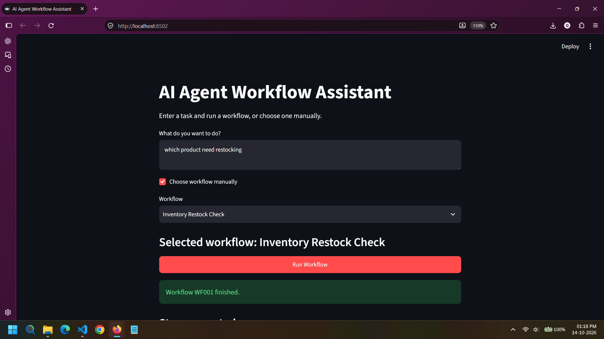

# AI Workflow Assistant

This is a small Streamlit app for running ten workflows from the Excel file in `data/`. Enter a request and click **Run Workflow** to let Gemini choose and run it. You can also select **Choose workflow manually** to run a workflow directly, including the inventory restock check.

## Workflows

1. Inventory restock check
2. Product price validation
3. Vendor file processing
4. Product description
5. Order status
6. Duplicate product check
7. Marketing campaign brief
8. Keyword classification
9. Employee task assignment
10. Workflow performance report


## Run it

Install the packages and start Streamlit:

```powershell
pip install -r requirements.txt
streamlit run app.py
```

Gemini is required for automatic workflow selection and product descriptions. Manual selection avoids Gemini for choosing a workflow, but the product-description workflow still needs the API. Copy `.env.example` to `.env` and add your API key. Business workflow data comes from the included CSV files; no live inventory or order service is connected.

## How the code is set up

- `data/workflows.xlsx` has the workflow names and steps.
- `agent.py` uses Gemini function calling to choose a workflow and generate product copy.
- `registry.py` connects each workflow ID to its Python function.
- `actions.py` contains the ten workflow functions.
- `data_io.py` reads the local CSV files.
- `app.py` is the screen for entering a request and seeing the result.

The CSV files have a few demo rows. Replace them with your own data. Price checks join `prices.csv` and `vendor_prices.csv` by SKU. Employee assignment reads `employees.csv`; the report reads `execution_logs.csv`. Vendor processing takes an uploaded CSV or XLSX and saves the clean and invalid rows in `outputs/`.

The columns are: `inventory.csv` has `name,stock,minimum`; `prices.csv` has `sku,price`; `vendor_prices.csv` has `sku,vendor_price`; `orders.csv` has order and shipment details; `products.csv` has `sku,name`; `employees.csv` has skills and workload; and `execution_logs.csv` has run time and error details.

## Try these requests

- Which products need restocking?
- Check vendor prices for large differences.
- Clean this vendor spreadsheet.
- Write a description for a cotton shirt for hikers.
- Find order ORD-1001.
- Find duplicate products.
- Make a campaign brief for a spring sale.
- Classify these keywords: buy shoes, best T-shirts, how to wash hoodies.
- Assign a Python task to an available employee.
- Show the workflow performance report.

Example results from the demo CSVs are in `examples/results.json`. To run the checks:

```powershell
python -m unittest test_flows -v
```

To add another workflow, add it to the Excel file, add a function to `actions.py`, connect its ID in `registry.py`, and add input fields to `app.py` if needed. Gemini reads the workflow definitions from Excel when choosing.

